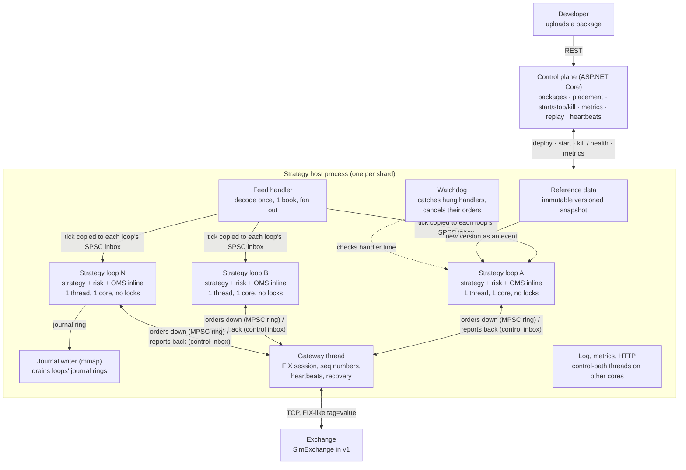
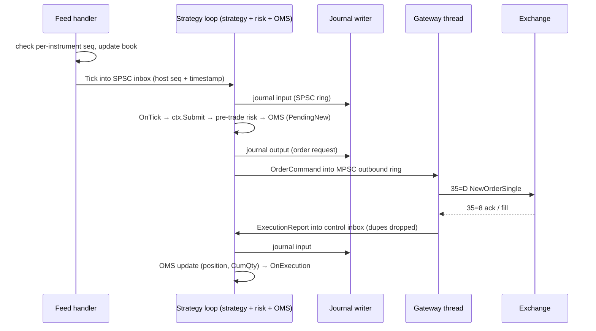
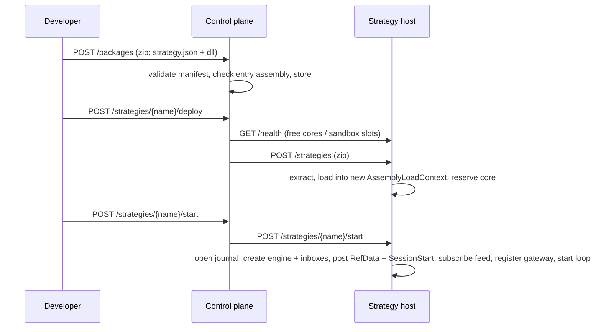
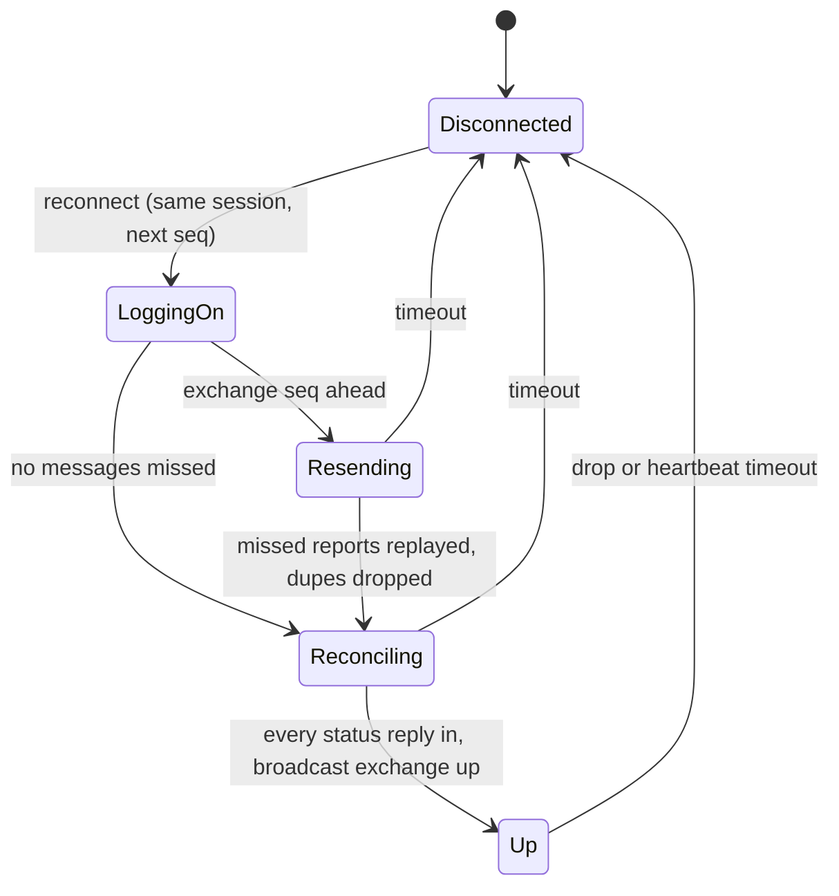

# Algo Strategy Hosting Platform: Architecture Design

The platform hosts strategy components written by many developers. Each strategy runs on its own single-threaded event loop, with market data, reference data, pre-trade risk and order management in the same process, so a tick becomes an order in about a microsecond. Orders leave only through one gateway thread, and only after passing risk and the OMS.

Related documents: [DESIGN_DECISIONS.md](DESIGN_DECISIONS.md) (why each choice was made), [PERFORMANCE.md](PERFORMANCE.md) (measured numbers), [PROGRESS.md](PROGRESS.md) (build status), and the original spec [AlgoPlatform_Requirements_Architecture.md](../AlgoPlatform_Requirements_Architecture.md).

## 1. Purpose and scope

The platform answers the QRT design question: many developers add components, all of them must run fast, and none may hurt the others. The design splits the system into two paths and keeps everything slow off the first one:

- **Hot path:** market data → strategy → risk → OMS → gateway.
- **Control path:** deploy, configuration, metrics, logging, persistence.

**Goals**

- A developer writes a small class against a stable SDK, uploads it, and runs it against live, recorded or simulated data.
- Every strategy runs fast and predictably. A slow or crashing strategy affects only itself.
- The same strategy binary runs unchanged in three modes (table below).
- Every order passes pre-trade risk, then the OMS, then the exchange gateway.
- Every input is journalled, so a session can be replayed with identical outputs.

**Non-goals for v1:** real exchange connectivity (a FIX-like TCP simulator stands in), multiple datacentres, a GUI, and strategies not written in .NET.

| Mode | Market data | Exchange | Clock | Used for |
| --- | --- | --- | --- | --- |
| Live | Feed handler | Gateway over TCP to an external exchange (SimExchange in v1) | Monotonic | Production trading |
| Paper | Feed handler | Embedded SimExchange on loopback, matching against the host's own quotes | Monotonic | Testing against live data with no risk |
| Replay | A recorded journal, or a synthetic feed | None (journal replay) or an in-process matcher (backtest) | Virtual | Regression tests, post-incident analysis, fast backtests |

## 2. Technology stack

The platform is plain .NET 8 and C#. It has no message broker, database or third-party runtime library; its speed comes from techniques in the code.

| Layer | Technology | Why |
| --- | --- | --- |
| Runtime | .NET 8 (LTS), C# 12, nullable on | Long-term support; mature JIT; spans, `ref` returns and struct generics allow allocation-free code |
| Strategy loading | `AssemblyLoadContext` (collectible, one per package) | Each developer's code and dependencies are isolated and can be unloaded. The SDK is shared so `IStrategy` has one identity |
| Inter-thread queues | Custom lock-free SPSC and MPSC ring buffers | Bounded, power-of-two, cache-line padded: 2.2 ns (SPSC) and 8.6 ns (MPSC) per enqueue + dequeue. `Channel<T>` and `async` add allocation and scheduling jitter |
| Threads | One dedicated `Thread` per loop, with optional pinning (`SetThreadAffinityMask` / `sched_setaffinity`) | A loop owns a core and never waits. No thread pool and no `Task` on the hot path |
| Journal | Memory-mapped append-only file (`MemoryMappedFile`) | Appends are memory copies. A dedicated thread writes them, so a strategy loop never does I/O |
| Exchange protocol | FIX-like tag=value over non-blocking TCP `Socket` | Encoded straight into a pre-allocated `byte[]` with `Utf8Formatter`, without `string.Format` |
| Prices | Fixed-point `long` (price × 10^4) | No `double` rounding, no `decimal` cost, exact equality for replay |
| Control plane and host API | ASP.NET Core minimal APIs on Kestrel, JSON | Control path only; REST is simple to call and test |
| Metrics | Prometheus text format; HDR-style log-linear histogram (own code) | Fixed buckets, about 1 ns to record, no allocation; any Prometheus can scrape it |
| Logging | Non-allocating structured log ring + a drain thread writing JSON lines | `ctx.Log` enqueues a struct holding a constant template and two numbers; formatting happens off the loop |
| GC settings | Workstation GC, `SustainedLowLatency`, TieredPGO off | Fewer and shorter pauses; the hot path allocates nothing, so the GC rarely runs |
| Tests | xUnit (69 tests) | Unit, property and multi-threaded integration tests, including all ten acceptance tests |
| Benchmarks | BenchmarkDotNet + a custom latency harness | Micro-benchmark costs, plus end-to-end tick-to-order latency measured without coordinated omission |

**Low-latency techniques used throughout:**

- One thread per strategy, with no locks.
- Structs for events, and pre-sized open-addressing maps.
- No LINQ, closures, boxing or string formatting on the hot path.
- Fixed-point prices and explicit binary codecs.
- A busy-spin or spin-then-yield idle strategy.

## 3. Logical architecture

The system has two planes. The control plane manages strategies over REST and never touches the hot path. Each strategy host is a process that runs the hot path for its strategies.

A tick flows down this picture: feed handler, each loop's inbox, then the strategy, risk and OMS on that loop, then the outbound ring to the gateway and out to the exchange. Execution reports come back up the same way into each loop's control inbox. Reference data versions, kills and timers enter as events, so every loop's journal records exactly what it saw.

## 4. Components

The solution has 12 source projects and 2 test projects. Dependencies point one way: the SDK depends on nothing, Core depends on the SDK, the domain libraries depend on Core, and the Host wires them together.

| Project | Responsibility | Key types |
| --- | --- | --- |
| `AlgoPlatform.Sdk` | The only contract a developer codes against. No dependencies | `IStrategy`, `IStrategyContext`, `Tick`, `ExecutionReport`, `NewOrder`, `RejectCodes` |
| `AlgoPlatform.Core` | Ring buffers, event-loop thread, idle strategies, clocks, histogram, sequencer, journal, manifest, log ring, Prometheus writer | `SpscRing`, `MpscRing`, `EventLoopThread`, `JournalService`, `HostEvent` |
| `AlgoPlatform.MarketData` | Simulated feed, per-instrument order book, feed handler with gap recovery, per-subscriber inbox with conflation | `SimulatedFeed`, `FeedHandler`, `OrderBook`, `MarketDataInbox` |
| `AlgoPlatform.ReferenceData` | Immutable versioned instrument master, loaded from JSON and swapped atomically | `ReferenceDataSnapshot`, `ReferenceDataService` |
| `AlgoPlatform.Oms` | Order state machine, order ids, positions and PnL, idempotent fills, open quantity per side | `OrderManager`, `OrderState` |
| `AlgoPlatform.Risk` | Pre-trade checks and the rate limiter; fails closed | `PreTradeRisk`, `RateLimiter` |
| `AlgoPlatform.Gateway` | FIX codec and the single-writer exchange session: sequence numbers, heartbeats, resend, reconciliation, throttle | `ExchangeGateway`, `FixWriter`, `FixMessage`, `FixFramer` |
| `AlgoPlatform.SimExchange` | TCP exchange simulator: matching, partial fills, persistent sessions, resend store, disconnect injection | `SimExchange` |
| `AlgoPlatform.Host` | The strategy host process: the engine (the context a strategy sees), slots and loops, watchdog, placement, metrics, package loading, HTTP API | `StrategyEngine`, `StrategySlot`, `StrategyHost`, `StrategyLoader`, `HostApi` |
| `AlgoPlatform.Replay` | Deterministic journal replay and backtesting on a virtual clock | `JournalReplayer`, `BacktestRunner` |
| `AlgoPlatform.ControlPlane` | REST API: packages, hosts, placement, start/stop/kill, metrics aggregation, replays, heartbeats | `ControlPlaneApp`, `ControlPlaneState` |
| `AlgoPlatform.Strategies.Samples` | Reference strategies used by tests and the demo | `MarketMaker`, `ThresholdBuyer` |
| `AlgoPlatform.Tests` | 69 xUnit tests, including the ten acceptance tests | |
| `AlgoPlatform.Benchmarks` | Latency, fan-out and allocation harness; BenchmarkDotNet micro-benchmarks | `LatencyHarness`, `MicroBenchmarks` |

## 5. Threading and memory model

Each strategy gets one thread that owns all of its state, so strategy code needs no locks. Threads talk only through bounded lock-free rings, and the hot path allocates nothing.

| Thread (per host) | Count | Does | Idle mode |
| --- | --- | --- | --- |
| Strategy loop | 1 per strategy | Drains its control inbox, fires due timers, drains market data; runs strategy, risk and OMS inline | BusySpin (dedicated core) or Backoff (sandbox) |
| Feed handler | 1 | Reads the feed, checks sequence numbers, updates books, fans ticks out | Spin |
| Gateway | 1 | Owns the TCP session; encodes orders, decodes reports, routes them to inboxes | Spin |
| Journal writer | 1 | Drains every strategy's journal ring into its memory-mapped file | Backoff |
| Log drain, watchdog, HTTP, async workers | several | Control path only | Blocking or sleeping |

**Inboxes.** Each strategy has two:

- A **market-data inbox**: an SPSC ring from the feed handler. When it is full, quotes are conflated to the latest one per instrument. Trades and status events go to an overflow FIFO and are never dropped. If the FIFO fills as well, the strategy is kill-switched.
- A **control inbox**: an MPSC ring written by the gateway (execution reports), the host (kill, stop, reference data) and async workers. It never drops events. On overflow, events go to a locked queue and the strategy is marked slow.

The loop drains the control inbox first, so a kill or a fill is never stuck behind market data.

**Ring buffers.** Capacity is a power of two, so the slot index is `seq & mask`. Producer and consumer cursors sit in separate 192-byte padded regions to avoid false sharing, and each side caches the other's cursor, so the common case touches no shared cache line. MPSC producers claim a slot with a CAS and publish it by writing a per-slot sequence number (Vyukov's design).

**Event struct.** `HostEvent` has a fixed size. `Tick` and `ExecutionReport` overlap in an explicit layout, because the struct is copied once per subscriber on fan-out.

**Allocation discipline.** Events are structs, maps are pre-sized open-addressing tables, histograms use fixed buckets, and encoders write into pre-allocated buffers. Duplicate ExecIds are tracked per order rather than in a global set that would grow. Measured result: 0 bytes allocated on the loop thread over 10 million ticks and 1 million orders.

**Capacity is cores.** A dedicated-core strategy takes one core from the host's budget, after the first two cores go to the feed handler and the gateway. When no core is free, a deployment is refused, never overcommitted.

## 6. Workflows

Five workflows cover the platform:

1. A tick becoming an order.
2. Deploying a strategy.
3. The kill switch.
4. Recovering from an exchange disconnect.
5. Replaying a session.

### 6.1 Tick to order (hot path)

1. The feed handler reads a feed message, checks its per-instrument sequence number, and updates that instrument's order book once.
2. If the top of book changed or a trade printed, it stamps a host sequence number and a timestamp, then copies one `Tick` into each subscribed strategy's market-data inbox.
3. The strategy loop dequeues the tick, appends it to its journal ring, updates risk's last mid, and calls `OnTick`.
4. The strategy calls `ctx.Submit(order)`, and pre-trade risk runs inline. The checks are: kill switch, exchange up, validity, reference data, lot and tick size, max quantity, stale data, price band, fat finger, notional, position including working orders, gross limit and rate limit. A failure returns a rejected handle immediately and is journalled.
5. On success, the OMS assigns a deterministic order id (`strategyId << 40 | counter`) and records the order as `PendingNew`. The order request is journalled and pushed onto the gateway's outbound MPSC ring.
6. The gateway thread encodes `35=D` into a pre-allocated buffer and sends it with the next outbound sequence number.
7. Acks and fills come back on the same socket. The gateway decodes them, drops duplicates, stamps a host sequence number, and routes each one using the strategy id inside the order id.
8. The strategy loop journals the report, applies it to the OMS (position, CumQty, LeavesQty), and calls `OnExecution`.

Measured with one strategy: steps 2 to 5 take 1.2 µs at p50 and 17.4 µs at p99.

### 6.2 Deploy a strategy

1. The developer zips `strategy.json` together with the strategy assembly and POSTs it to the control plane's `/packages` endpoint.
2. The control plane validates the manifest (name, entry type, instruments, mode, resource class, limits), checks that the entry assembly is in the zip, and stores the package.
3. `POST /strategies/{name}/deploy` triggers placement. A `dedicated-core` strategy goes to a production host with a free core, and a `shared` strategy goes to a sandbox host with a free slot. A redeploy prefers the host the strategy is already on. If there is no capacity, the answer is `409`.
4. The control plane sends the zip to the chosen host. The host extracts it, loads the entry type into a new collectible `AssemblyLoadContext`, and reserves a core.
5. On `POST /start`, the host does the following in order:
   1. Opens a journal and creates the engine and inboxes.
   2. Posts `ReferenceData` and `SessionStart` as the first two events.
   3. Subscribes the strategy to market data.
   4. Registers it with the gateway, which then posts the current exchange status.
   5. Starts the loop thread. `OnStart` runs on the loop.
6. Hot reload means redeploying the same name. The old version is stopped and unloaded, and the new one is loaded. State is not migrated.

### 6.3 Kill switch

A kill can be raised per strategy, per host, or globally (`POST /kill` fans out to every host).

1. The host posts a `Control(Kill)` event to the strategy's control inbox.
2. The loop drains control first. In that same iteration it sets the risk kill flag and sends a cancel for every live order. With `flatten`, it also sends market IOC orders that close the positions.
3. Every later `Submit` returns `KillSwitch`. Cancels that were refused because the exchange was down are re-sent when it comes back.

In the journal, the `Kill` record is followed immediately by one cancel per live order, before any other input. A test checks this.

### 6.4 Exchange disconnect and recovery

1. Any of three things ends the session: a failed receive, a failed send, or no inbound traffic for three heartbeat intervals. The gateway then broadcasts `ExchangeStatus(down)`, so every strategy's risk fails closed. Commands that arrive while the session is down are answered locally with `ExchangeDown`.
2. The gateway reconnects and logs on with its next sequence number. The exchange keeps the session, keyed by SenderCompID.
3. If the exchange's logon sequence number is ahead of what the gateway expected, the gateway sends a resend request (`35=2`). The exchange replays the stored reports with `PossDup=Y`, and duplicates are dropped by ExecId.
4. If the exchange asks the gateway to resend, the gateway answers with a gap fill (`35=4`). It never re-sends an order.
5. The gateway sends an order status request (`35=H`) for every order it still believes is open. An order the exchange does not know becomes `Rejected (UnknownAtExchange)`. Nothing is assumed filled or lost.
6. When every status reply is in, the session is Up. The gateway broadcasts `ExchangeStatus(up)` and sends any pending cancel-alls.

### 6.5 Deterministic replay

1. The control plane fetches the strategy's raw journal from the host and loads the chosen package version.
2. `JournalReplayer` rebuilds the engine from the `SessionStart` record, which holds the strategy id and the manifest.
3. It feeds every journalled input in order, setting a virtual clock to each event's timestamp. Timers and async work are not run, because their results are already in the journal as events.
4. It compares the order requests the replay produces with those journalled by the original run, byte for byte, and returns a SHA-256 digest.

Replay works even though the original run used real threads, because of three rules:

- Everything that can change an output is an input event, journalled before it is handled.
- `ctx.NowNs` is the timestamp of the event being handled, not the wall clock.
- Decisions taken for timing reasons, such as timers and budget kills, are injected as events.

## 7. Data and interfaces

All hot-path data are fixed-size structs with fixed-point prices. JSON appears only on the control path.

**Strategy SDK.** A strategy implements `IStrategy`: `OnStart`, `OnTick`, `OnExecution`, `OnTimer`, `OnReferenceDataChanged`, `OnAsyncResult` and `OnStop`. It acts only through `IStrategyContext`: `Submit`, `Cancel`, `Replace`, `SetTimer`, `RunAsync`, `Log`, `GetPosition`, `Reference`, `NowNs`, `Instruments` and `GetParameter`. A strategy never touches threads, sockets, files or the wall clock.

**Manifest (`strategy.json`).** It holds:

- name and version;
- entry type, written as `Namespace.Type, Assembly`;
- instruments and run mode;
- resource class: `dedicated-core` or `shared`;
- limits: max order quantity, max position, max notional, orders per second, plus an optional gross limit and fat-finger bps;
- free-form parameters.

**Internal events.** A `HostEvent` carries one of these kinds:

- `Tick`
- `Execution`
- `Timer`
- `ReferenceData`
- `AsyncResult`
- `Control`: `Kill`, `KillAndFlatten`, `Stop` or `MarkSlow`
- `InstrumentStatus`: stale or ok
- `ExchangeStatus`: up or down
- `SessionStart`

Strategy outputs are `OrderCommand`s: `New`, `Cancel`, `Replace` or `CancelAllForStrategy`.

**Exchange wire format.** FIX-like tag=value with SOH separators, BodyLength and CheckSum.

| Messages | Tags |
| --- | --- |
| `A` Logon, `0` Heartbeat, `1` TestRequest, `2` ResendRequest, `4` SequenceReset, `5` Logout, `D` New, `F` Cancel, `G` Replace, `H` OrderStatusRequest, `8` ExecutionReport, `9` CancelReject | 11 ClOrdID, 41 OrigClOrdID, 37 OrderID, 17 ExecID, 55 Symbol, 54 Side, 38 OrderQty, 40 OrdType, 44 Price, 59 TimeInForce, 39 OrdStatus, 150 ExecType, 14 CumQty, 151 LeavesQty, 31 LastPx, 32 LastQty, 34 MsgSeqNum, 43 PossDupFlag, 49/56 CompIDs, 7/16/36/123 resend and gap fill, 103 OrdRejReason, 434 CxlRejResponseTo |

**Journal file.** There is one file per strategy session:

- a 16-byte header (`APJ1` and a version);
- then records laid out as `[Seq:8][TimestampNs:8][Type:4][Length:4][payload]`, little-endian;
- record types 1–9 are inputs and 100+ are outputs.

Records are encoded field by field, so struct padding bytes never reach the file. Reference data and session records carry a JSON blob, so a journal can be replayed on its own.

**REST APIs**

| Control plane | Host |
| --- | --- |
| `POST /hosts`, `GET /hosts` | `GET /health`, `GET /metrics` |
| `POST /packages`, `GET /packages` | `GET /strategies`, `POST /strategies` (zip) |
| `POST /strategies/{name}/deploy` | `POST /strategies/{name}/start` · `/stop` · `/kill` |
| `POST /strategies/{name}/start` · `/stop` · `/kill` | `POST /kill` |
| `GET /strategies`, `GET /strategies/{name}/journal` | `GET /strategies/{name}/journal`, `/journal/raw` |
| `POST /kill`, `GET /metrics`, `GET /alerts` | `DELETE /strategies/{name}` |
| `POST /replays`, `GET /replays/{id}` | |

**Metrics** use the Prometheus text format.

- Per strategy: status, events, ticks, queue depths, conflated quotes, orders sent and rejected, fills, budget breaches and journal stalls, plus summaries of handler time, tick-to-order latency and inbox latency.
- Per host: GC counts, and feed and gateway counters.

## 8. Failure handling and isolation

A failure stops the strategy that caused it and leaves its neighbours running. Risk fails closed whenever one of its inputs is missing or stale.

| Failure | Response |
| --- | --- |
| Strategy throws | Caught at the loop boundary: working orders are cancelled, status becomes Faulted, callbacks stop, and an alert is raised. Other strategies continue |
| Handler exceeds the 20 µs budget | Each breach is counted and logged. Ten in a row inject `MarkSlow`: kill switch, callbacks stop, market data detached |
| Handler hung (default 1 s) | Watchdog thread: the gateway blocks the strategy and cancels its open orders, market data is detached, and an alert is raised. The thread cannot be aborted, so the host needs a restart |
| Inbox full | Quotes are conflated; trades and reports are never dropped. If the overflow also fills: kill switch and status Slow |
| Feed sequence gap | The instrument is marked stale (risk rejects orders in it), rebuilt from a snapshot, then marked recovered |
| Exchange disconnect | Risk fails closed; resend, dedupe and reconcile happen before Up (section 6.4) |
| Duplicate execution report | Ignored by ExecId, in both the gateway and the OMS |
| Missing reference data | Order rejected |
| Host process dies | The control plane misses its heartbeats, marks the host Down and raises an alert. v1 has no automatic restart |
| Clock jump | All logic uses the monotonic clock; the wall clock is used only for log timestamps |

**Isolation levels**

- **Between strategies on one host:** separate threads, inboxes, load contexts and OMS state, plus the handler budget and the watchdog. A fatal runtime fault (stack overflow, `FailFast`) still kills the whole host.
- **Between hosts:** separate processes. Untrusted or experimental (`shared`) strategies go to sandbox hosts, which run unpinned, backing-off loops. Production strategies get their own host, or share one with trusted peers.

## 9. Measured performance and known gaps

The p99 latency, allocation, determinism and recovery targets are met; the p99.9 latency and 50-subscriber fan-out targets are not. The numbers come from the benchmark harness, run on an Intel i7-9850H laptop (6 cores, 12 logical) with Windows 11 and .NET 8, without thread pinning or core isolation. Details are in [PERFORMANCE.md](PERFORMANCE.md).

| Target | Measured | Met |
| --- | --- | --- |
| Tick-to-order p99 < 50 µs (1 strategy) | p50 1.2 µs, p99 17.4 µs | Yes |
| Tick-to-order p99.9 < 200 µs | 303 µs | No |
| Zero hot-path allocation | 0 bytes over 10M ticks and 1M orders | Yes |
| 1M ticks/s per feed handler to 50 strategies, no lost trades | No lost trades; 0.30M ticks/s to 50 subscribers (1.4M to 10, 3.6M to 1) | No |
| Replay identical over 100 runs | 100/100 identical, and equal to the live run | Yes |
| Gateway recovers without duplicate or lost orders | Verified with an injected disconnect | Yes |
| A bad strategy does not hurt its sibling | Sibling p99 was 10.2 µs alone and 9.7 µs next to a strategy that sleeps 50 ms per tick | Yes |

Tick-to-order is measured from each feed message's *intended* send time, so a stall counts as latency rather than disappearing (no coordinated omission). With 10 or 50 strategies on 12 logical processors, p99 rises to hundreds of µs because the loops are time-sliced. This is why the capacity planner refuses to overcommit cores.

**Next improvements**

- **Fan-out:** replace the per-subscriber copies with one shared broadcast ring and a read cursor per strategy (Disruptor pattern). Publishing would then cost one write, whatever the number of subscribers.
- **Tail latency:** run on Linux with isolated, pinned cores, and keep the simulator and REST traffic out of the trading process. The in-process simulator allocates, and the resulting GCs pause every thread.
- **FIX encoding (288 ns):** precompute the constant header bytes and the checksum.

**Known gaps in v1**

- No automatic host restart.
- A hung thread cannot be reclaimed without restarting the host.
- No ReadyToRun publish, and no warm-up gate before live data.
- No NUMA-aware core selection.
- No authentication on the REST APIs.
